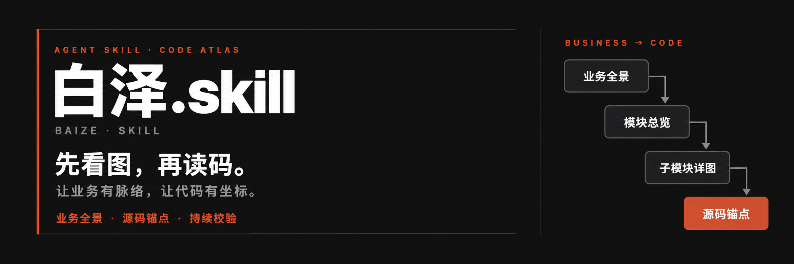
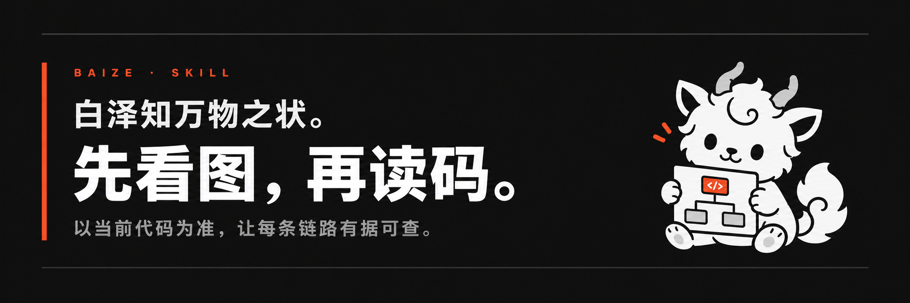

<p align="right"><a href="README.md">中文</a> · English</p>



# Baize · baize-skill

**See the business flow. Find the code that runs it.**

Baize is a shared business map for product teams, testers, developers and AI. It connects the overall flow, its branches and handoffs to the code that implements them, so the team can discuss the same business using the same Markdown document.

| Reader | What the map helps them do |
| --- | --- |
| Product teams | Check business rules and where exceptions lead, against the intended requirements. |
| Testers | List successful and failed paths, cancellations, retries and handoffs. |
| Developers | Follow business steps across application layers to the relevant code entry points. |
| AI | Narrow the context to the relevant sub-flow, then read its source code to verify the implementation. |

Developers and AI usually build and maintain the map. Product and test teams can read it directly during reviews. The same map can also help architects and new teammates understand how the system fits together.

The long-term aim is to make the business knowledge of complex systems a shared asset that teams and AI can verify and keep up to date.

Baize is an Agent Skill: instructions, references and small Node.js tools that help an AI trace a business flow through actual code. It produces Chinese Markdown documentation with three reading levels:

```text
Business overview -> Module overview -> Sub-flow detail
                                           |
                       +-------------------+-------------------+
                       |                                       |
                       v                                       v
                Business branches                       Implementation cards
                       +--------------- Node IDs --------------+
                                           |
                                           v
                                  Source-code anchors
```

In the [login example](examples/账号登录.md), readers follow sign-in steps and branches on the left, then use the matching node IDs to find implementation cards and source anchors on the right. Everyone reads the same Markdown. The example is fictional, has no corresponding source code, and is not a verified authentication design.

Baize works with frontend-only, backend-only, full-stack, native and scheduled-task projects. It maps what exists, labels external boundaries, and records uncertainty rather than inventing connections. Frontend maps include response handling, not just outgoing requests.

See the [Chinese guide](README.md) for the full workflow.

## Install into a project

Download this repository through **Code → Download ZIP**, extract it, rename the directory from `baize-skill-main` (or another branch suffix) to **`baize-skill`**, and put it in the relevant project-local directory. `SKILL.md` must sit directly inside it.

| Client | Recommended project directory | Invocation |
| --- | --- | --- |
| [Claude Code](https://code.claude.com/docs/en/skills) | `.claude/skills/baize-skill/` | `/baize-skill` |
| [Codex CLI](https://learn.chatgpt.com/docs/build-skills) | `.agents/skills/baize-skill/` | `$baize-skill` or select through `/skills` |
| [Gemini CLI](https://geminicli.com/docs/cli/skills/) | `.gemini/skills/baize-skill/` or `.agents/skills/baize-skill/` | Explicitly ask the model to use the skill |
| [Copilot CLI](https://docs.github.com/en/copilot/how-tos/copilot-cli/customize-copilot/add-skills) / [VS Code](https://code.visualstudio.com/docs/copilot/customization/agent-skills) | `.github/skills/baize-skill/` | `/baize-skill` |
| [Cursor](https://cursor.com/docs/context/skills) | `.cursor/skills/baize-skill/` | `/baize-skill` |
| [OpenCode](https://opencode.ai/docs/skills/) | `.opencode/skills/baize-skill/` | Explicitly ask the model to use the skill |

Copilot, Cursor and OpenCode also document `.agents/skills/` and `.claude/skills/` support. Do not assume `.agents/skills/` is universal: Claude Code documents `.claude/skills/`.

Alternatively, clone this repository into the chosen directory using the clone URL from its **Code** button. Remove **only the cloned Skill's `.git` directory**, not your project's `.git`, so the Skill can be versioned as ordinary project files. This package does not provide a guessed repository URL.

Restart your client session if needed. Verify the Skill is discoverable before starting.

### Multiple clients and upgrades

Keep one real copy per project to avoid divergent settings and experience notes. For Claude Code and Codex, a real copy in `.agents/skills/baize-skill/` can be shared through a symlink at `.claude/skills/baize-skill/`. Both document support for skill-directory symlinks. Gemini offers `skills link`; other clients' cited pages do not explicitly guarantee symlink support.

Do not install globally or share the same configured directory across different projects.

When upgrading, back up and preserve these locally generated paths:

```text
references/项目设置.md          Project settings
references/探查经验/            Project-specific investigation notes
```

Do not delete the entire directory before upgrading. Documentation lives separately under `docs/链路全景/` in the **current project directory**, not necessarily the Git repository root. Use the same project directory for future calls. Check whether your `.gitignore` prevents the Skill and its local knowledge from being shared with your team.

## Optional: source-code graph MCP

[codebase-memory-mcp](https://github.com/DeusData/codebase-memory-mcp) can help the AI find definitions and trace callers and callees before reading only the relevant source. Baize organizes that evidence into the business-flow map. Baize's `refs` searches documented references; the MCP searches source relationships. Less unrelated reading can reduce token use, but indexing has an initial cost and there is no fixed speed or token-saving guarantee.

It is **optional**. Without it, Baize continues with text search. If you want your AI coding client to set it up, send:

```text
Please install codebase-memory-mcp and connect it to Baize for this project.
Use the latest official instructions:
https://github.com/DeusData/codebase-memory-mcp

Identify my OS, AI client, and existing MCP configuration first.
Explain the downloads, configuration changes, and indexing scope, then wait
for my confirmation. Prefer project-local configuration; do not silently
change global settings or overwrite existing MCP or AGENTS.md instructions.

After approval, reuse or install the server, confirm that this session can
call it, and reuse or build the authorized project index. Check a known symbol.
Then update Baize's references/项目设置.md with the code-graph tool,
verified index identifier, and scope. If settings do not exist, draft the
complete settings for my confirmation. Preserve other settings and notes.
Do not edit application code, commit, or push. Tell me if permissions,
reconnection, or a client restart require my action.
```

Baize already includes the [graph-search rules](references/源码图谱MCP.md); installation only needs project-specific settings, not a per-machine rewrite of `SKILL.md`. Later runs check actual tool availability and index coverage rather than trusting a saved “installed” label.

The official installer may change user-level client configuration. Claude Code supports manual project `.mcp.json` configuration; other clients use their own formats. Follow the current official instructions rather than applying one command to every client. Local indexing does not mean results stay outside your AI model context, and the MCP has its own local daemon/background watcher. See the [official configuration guide](https://github.com/DeusData/codebase-memory-mcp/blob/main/docs/CONFIGURATION.md).

## First use

You do not need to know a function name or exact entry point. Describe a symptom or business question:

```text
/baize-skill Users sometimes return to the login page after signing in. Map that flow.
/baize-skill Orders are not being cancelled after timeout. Trace how that works.
/baize-skill First show me this project's main business flows.
```

These examples use Claude Code / Copilot / Cursor syntax; use `$baize-skill` in Codex. In Gemini or OpenCode, explicitly ask to use `baize-skill` for the business-flow map.

The first run pauses at three points:

1. **Project settings:** the AI inspects the project read-only, proposes settings, and waits for approval before saving them inside the Skill.
2. **Entry point:** it presents candidates with source evidence and waits for your choice—even if there is only one candidate.
3. **Scope:** it proposes the start, end, branches and decomposition, then waits for approval.

It then traces source code, draws and checks the map, and reports unverified parts. Later runs read existing settings first. Explicitly read-only tasks do not write settings, documentation or experience notes; proposed settings remain in the conversation.

Runtime tools require **Node.js 22+**; the verified 22 LTS version is recommended. The `.mjs` scripts use built-in modules only: no Python and no `npm install` are required. Git is needed only for change-based lookup and freshness hints. Run `node tests/run.mjs` for the Node-only test suite. The legacy Python implementation and its tests have been removed; both the tools and their maintained tests run on Node.js.

Static checks do not prove runtime correctness or authentication security. Source access is governed by your AI client's permissions and data policies. Do not store credentials, personal data or full logs in experience notes. Baize does not automatically commit or push.

---


